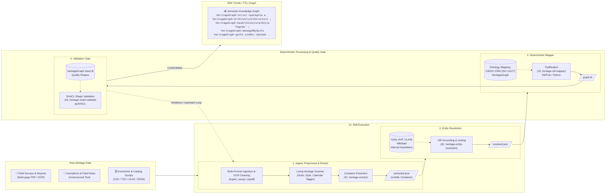

# HeritageGraph Skills (`hg-skill`)

Repository containing agent skills for transforming unstructured texts, archival records, multi-page PDF survey reports, and tabular cultural heritage datasets into validated, ontology-grounded RDF Turtle (`.ttl`) for contribution to the **[HeritageGraph](https://cairnepal.github.io/heritagegraphontology/)** platform by **CAIR-Nepal**.

This repository includes some copied skills from [mattpocock/skills](https://github.com/mattpocock/skills):
- code-review
- improve-codebase-architecture
- writing-for-agents

---

## Architecture & Transformation Pipeline



---

## Core Pipeline Stages

The transformation pipeline is organized under [`skills/`](skills/):

| Stage | Skill | Supported Raw Formats | Description | Primary Output |
|---|---|---|---|---|
| **00** | [00_heritage-to-rdf](skills/00_heritage-to-rdf/SKILL.md) | All | End-to-end pipeline orchestrator managing stages 1 through 4. | `graph.ttl` |
| **01** | [01_heritage-extract](skills/01_heritage-extract/SKILL.md) | **PDF**, **CSV**, **TSV**, **XLSX**, **JSON**, raw text | Ingests multi-page PDFs (with OCR line-repair), tabular sheets, and raw texts; scans living heritage; structures into LinkML `Container`. | `extracted.json` |
| **02** | [02_heritage-entity-resolution](skills/02_heritage-entity-resolution/SKILL.md) | `01_extracted.json` | Entity grounding via gazetteers, Getty (AAT/ULAN), and Wikidata, with interactive HITL review queue. | `02_resolved.json`, `02_review_queue.json` |
| **03** | [03_heritage-rdf-mapper](skills/03_heritage-rdf-mapper/SKILL.md) | `02_resolved.json` | Deterministic triplification into RDF Turtle using declarative CIDOC-CRM / HeritageGraph mappings. | `03_graph.ttl` |
| **04** | [04_heritage-shacl-validate](skills/04_heritage-shacl-validate/SKILL.md) | `03_graph.ttl` | Semantic and structural quality gate validating graphs with pySHACL against `HeritageGraph.shacl.ttl`. | `04_shacl_report.json` |

---

## Stage 1 Ingestion & Preprocessing

Stage 1 provides a unified CLI to ingest and prepare heterogeneous raw heritage data before LLM extraction:

```bash
# Multi-page PDF survey report (extracts text, rejoins hyphenated OCR breaks, strips running page noise)
python skills/01_heritage-extract/scripts/ingest_raw.py survey_report.pdf --out preprocessed.json

# Tabular inventory spreadsheet (separates administrative columns from narrative prose)
python skills/01_heritage-extract/scripts/ingest_raw.py monuments.csv --out preprocessed.json
python skills/01_heritage-extract/scripts/ingest_raw.py monuments.xlsx --out preprocessed.json

# Museum or archival catalog JSON dump
python skills/01_heritage-extract/scripts/ingest_raw.py catalog.json --out preprocessed.json
```

### Living Heritage Candidate Recognition
The preprocessor automatically tags candidate mentions aligned to LinkML enums in `schemas/HeritageGraph.yaml`:
- **Guthi Types**: `SiGuthi`, `RajGuthi`, `JatraGuthi`, `PujaGuthi`, `TempleGuthi`, `NashaGuthi`, `SanaGuthi`, `SanGuthi`.
- **Architectural Styles**: `Pagoda`, `Shikhara`, `Chaitya`, `Stupa`, `Dome`.
- **Calendar Eras**: Nepal Sambat (`NS`), Bikram Sambat (`VS`), Shaka Sambat (`ŚS`), Common Era (`CE/BCE`).
- **Religious Traditions**: Buddhist, Shaiva, Vaishnava, Shakta, Newar syncretic.

---

## Schemas & Ontology Versioning

* **Documentation**: [https://cairnepal.github.io/heritagegraphontology/](https://cairnepal.github.io/heritagegraphontology/)
* **LinkML Source Schema**: [`schemas/HeritageGraph.yaml`](schemas/HeritageGraph.yaml)
* **Ontology TTL**: [`schemas/HeritageGraph.ttl`](schemas/HeritageGraph.ttl)
* **SHACL Quality Shapes**: [`schemas/HeritageGraph.shacl.ttl`](schemas/HeritageGraph.shacl.ttl)
* **Upstream Sources**: [`schemas/SOURCES.md`](schemas/SOURCES.md)

### Updating Ontology Artifacts

To fetch or update ontology artifacts to a specific release tag, branch, or commit:

```bash
# Fetch latest from main (default)
python scripts/update_ontology.py

# Fetch a specific tag or branch
python scripts/update_ontology.py --ref v1.0.1
```

---

## Pipeline Run Workspace & Artifact Lifecycle

Every transformation execution operates in an isolated run workspace under `runs/<run_id>/` (e.g., `runs/2026-10-25_idjmss-patan/`). Stage artifacts follow a standardized ordering with full provenance tracked in `manifest.json`:

```
runs/<run_id>/
├── manifest.json         # Provenance envelope (source hash, git commit, timestamps, metrics)
├── 00_preprocessed.json  # Raw OCR text chunks & scanned candidate tags
├── 01_extracted.json     # Schema-validated LinkML Container
├── 02_resolved.json      # Entities reconciled with external/local URIs
├── 02_review_queue.json  # Staged candidate matches for human curator review
├── 03_graph.ttl          # Triplified CIDOC-CRM / PROV-O Turtle graph
└── 04_shacl_report.json  # SHACL conformance report & violation diagnostics
```

### Running the Pipeline

```bash
# 1. Ingest raw document into an auto-created or explicit run directory
python skills/01_heritage-extract/scripts/ingest_raw.py "survey_report.pdf"
# Emits runs/<date>_<slug>/00_preprocessed.json and initializes manifest.json

# 2. Extract into 01_extracted.json and validate
python skills/01_heritage-extract/scripts/validate_extraction.py --run-dir runs/<run_id>

# 3. Resolve entities (Stage 2 - batch mode with review queue staging)
python skills/02_heritage-entity-resolution/scripts/resolve_entities.py --run-dir runs/<run_id>

# Or resolve entities interactively with human curator terminal review:
python skills/02_heritage-entity-resolution/scripts/resolve_entities.py --run-dir runs/<run_id> --interactive

# 4. Map to RDF (Stage 3)
python skills/03_heritage-rdf-mapper/scripts/map_to_rdf.py --run-dir runs/<run_id>

# 5. SHACL Validate (Stage 4)
python skills/04_heritage-shacl-validate/scripts/validate.py --run-dir runs/<run_id>

# Or execute stages 2-4 end-to-end in one command (supports --interactive):
python skills/00_heritage-to-rdf/scripts/run_pipeline.py --run-dir runs/<run_id> --interactive
```
